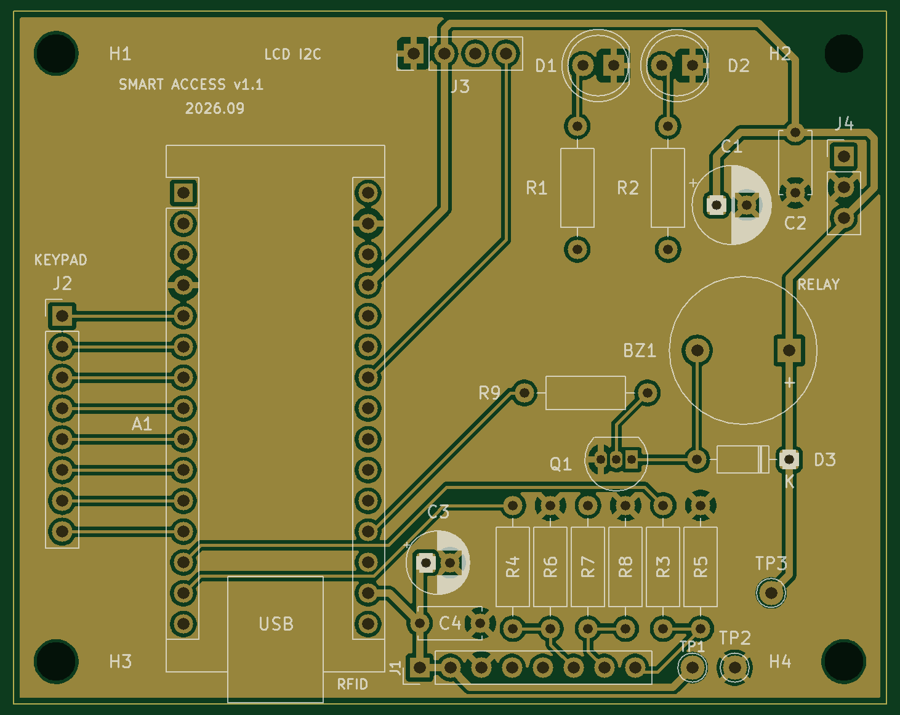
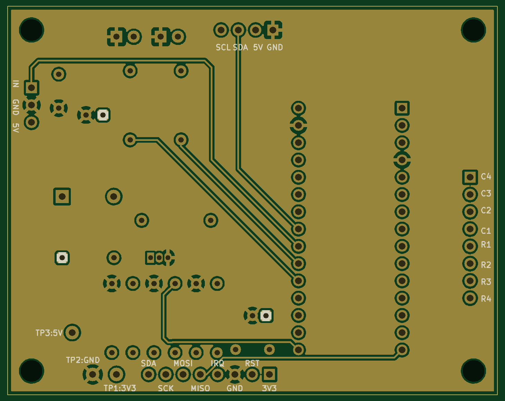

# Smart Access Control (RFID + PIN door lock)

Door lock controller on my own PCB. To open the door you need a 13.56 MHz
RFID card and a 4-digit PIN. An Arduino Nano checks both and switches a 12 V
electric strike through a relay.

| Top | Bottom |
|---|---|
|  |  |

*PCB v1.1 rendered from the Gerber files. Photos of the assembled board will
replace these renders.*

## Status

- [x] Firmware tested on a breadboard
- [x] Schematic and PCB v1.0 in KiCad
- [x] Review of v1.0, fixes in v1.1
- [x] PCB v1.1 ordered from JLCPCB ([fabrication files](Zamek_RFID_Hardware/fab/v1.1))
- [ ] v1.1 assembled and tested
- [ ] Firmware changes for v1.1 (see TODO)

## How it works

| Part | Interface |
|---|---|
| Arduino Nano (ATmega328P) | controller |
| MFRC522 RFID reader, module on a header | SPI |
| 4x4 keypad | GPIO |
| 16x2 LCD with I2C adapter | I2C |
| Relay module (active LOW) | GPIO |
| Buzzer, green LED, red LED | GPIO |

The firmware is a state machine:

`WAIT_FOR_CARD -> WAIT_FOR_PIN -> ENTERING_PIN -> GRANTED / DENIED -> WAIT_FOR_CARD`

The door opens only when both the card and the PIN are correct. The red LED is
on while the door is locked. If the card or the PIN is wrong, the buzzer beeps.

The full pin map is in the [schematic (PDF)](docs/schematic_v1.1.pdf). The
KiCad project is in [`Zamek_RFID_Hardware/`](Zamek_RFID_Hardware/Zamek_RFID_Hardware).

## Design notes

- The MFRC522 stays as a module on a header. It already has a tuned 13.56 MHz
  antenna, and designing my own antenna was out of scope.
- The relay module is active LOW. At power-up the strike opened for a moment,
  because the pin went LOW when it became an output. Writing HIGH to the pin
  before `pinMode()` fixed it.
- The board only drives the relay module's input. The strike and its 12 V
  supply connect to the relay module's own screw terminals.

## What I changed after the v1.0 review

- Fixed both status LEDs. In v1.0 they were wired in reverse and could never
  light up.
- Added decoupling: 100 nF + 100 uF on 5 V at the relay connector and
  100 nF + 10 uF on 3.3 V at the reader. A supply dip I had worked around in
  firmware was actually a hardware problem.
- Moved power nets to their own net class (0.6 mm) and added a GND pour on both
  layers. In v1.0 every track was 0.25 mm.
- Added level shifting on MOSI, SCK and SS (1k/2k dividers, 3.33 V). The
  MFRC522 runs at 3.3 V and its inputs allow at most VDD + 0.5 V, so 5 V from
  the Nano was out of spec.
- The buzzer is now driven through a BC547 transistor with a flyback diode, not
  directly from a GPIO pin.
- Added 4 M3 mounting holes, test points on 5 V, 3.3 V and GND, pin 1 marks and
  silkscreen labels for every connector pin.

## Limitations

This is a learning project, not a product.

- Only the card UID is checked. MIFARE Classic UIDs can be read and copied to
  cheap cards.
- There is no lockout after wrong PINs.
- The PIN is stored in plain text in the firmware.
- The reader's reset pin is tied to 3.3 V, so the Nano can only reset the
  reader in software.
- Someone with access to the inside of the installation can bridge the relay.

## TODO

- [ ] Replace `String` with a fixed `char` buffer (the ATmega328P has 2 kB of RAM)
- [ ] Replace `delay()` in the state machine with `millis()` timing
- [ ] 15 s timeout after a valid card
- [ ] Lockout after 5 wrong PINs, counter stored in EEPROM
- [ ] Check at boot that the RFID reader responds
- [ ] Stop printing card UIDs to the serial port
- [ ] Check the keypad connector order (J2) against the real keypad

## Build

PlatformIO, target `nanoatmega328new`.

```bash
cp include/config.example.h include/config.h   # set your card UID and PIN
pio run --target upload
```

## License

Firmware: [MIT](LICENSE). Hardware: [CERN-OHL-S-2.0](LICENSE-HARDWARE).
