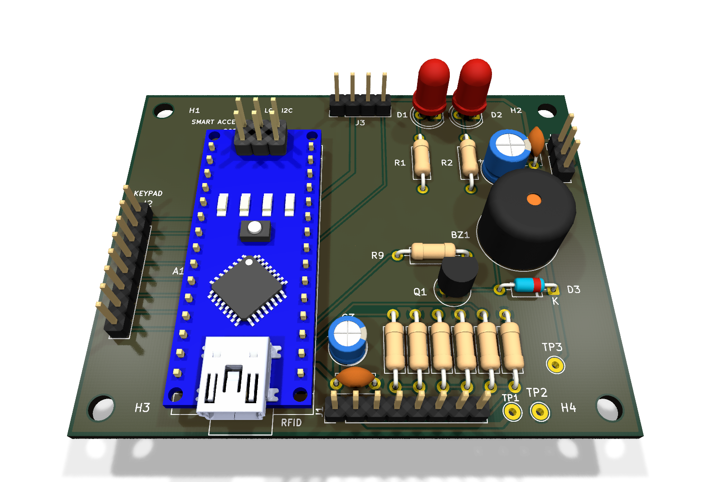
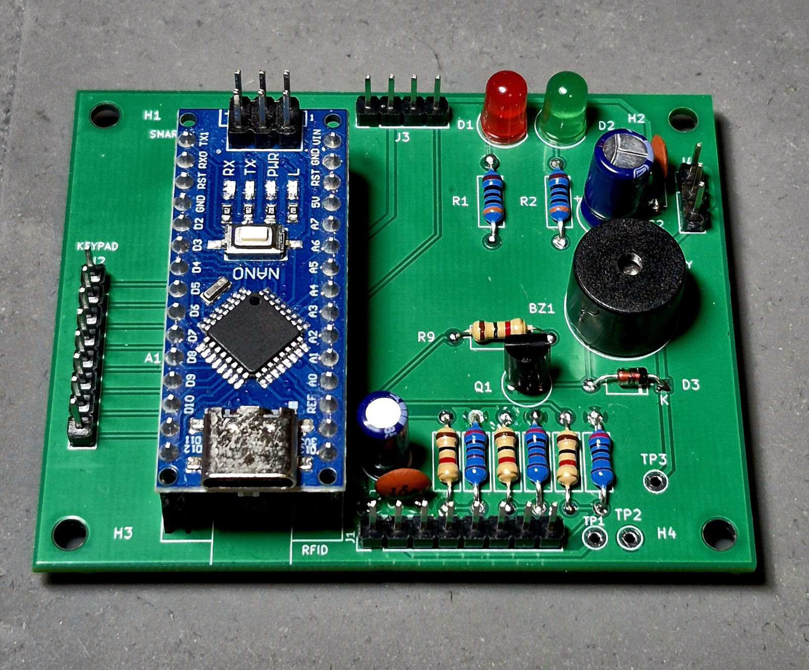
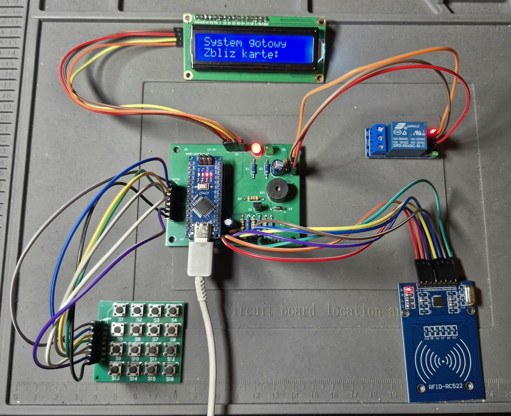
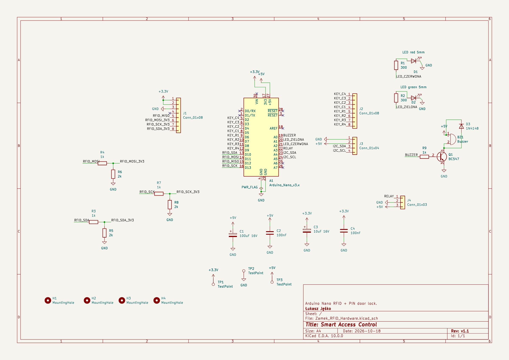
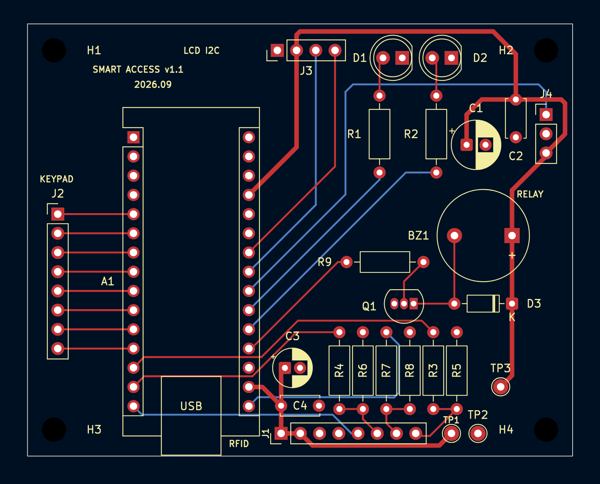
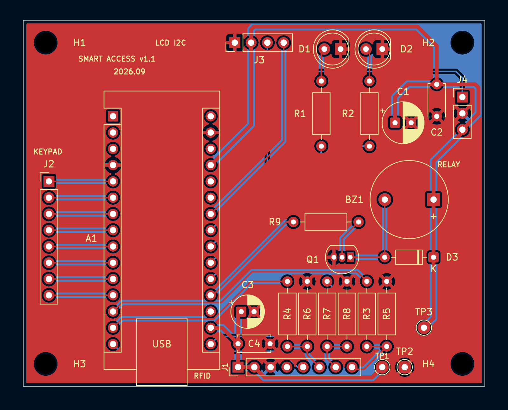

# Smart Access Control

A door lock controller on my own PCB. To open the door you need the right RFID card
and the right 4-digit PIN. An Arduino Nano checks both and switches a 12 V door strike
through a relay.

| KiCad 3D render | Assembled board |
|---|---|
|  |  |

This is the first PCB I designed and ordered. I drew v1.0 in KiCad, found a lot of
mistakes during a review, fixed them in v1.1 and ordered v1.1 from JLCPCB.

## What's on the board

Arduino Nano, MFRC522 RFID reader (as a module on a header), 4x4 keypad, 16x2 LCD over
I2C, relay module, buzzer and two LEDs.



The firmware is a simple state machine: wait for a card, wait for the PIN, open or deny,
then back to waiting.



| Routing (ground pour hidden) | All copper layers |
|---|---|
|  |  |

*Red = top copper, blue = bottom copper. On the left the ground pour is hidden so
the tracks are visible.*

Schematic as PDF: [docs/schematic_v1.1.pdf](docs/schematic_v1.1.pdf).
KiCad project: [Zamek_RFID_Hardware/](Zamek_RFID_Hardware/Zamek_RFID_Hardware).

## Mistakes in v1.0 that I fixed in v1.1

- Both LEDs were wired backwards, so they could never light up.
- There were no decoupling capacitors. I had a supply dip that I worked around in
  firmware, but the real problem was in hardware.
- Every track was 0.25 mm, including power. Now power tracks are 0.6 mm and there is
  a ground pour on both layers.
- The Nano sent 5 V signals into the 3.3 V RFID reader. Now there are 1k/2k resistor
  dividers on MOSI, SCK and SS.
- The buzzer was driven straight from a pin. Now it goes through a BC547 transistor
  with a flyback diode.
- No mounting holes and no test points. Now there are four M3 holes and test points on
  5 V, 3.3 V and GND.

## A bug I liked

The relay module is active LOW, so at power-up the door opened for a split second
before the program set the pin. Writing HIGH to the pin before `pinMode()` fixed it.

## Not done yet

- Assemble and test v1.1
- Firmware: replace `String` with a `char` buffer, replace `delay()` with `millis()`,
  lock the keypad after 5 wrong PINs
- Security: only the card UID is checked, and a UID can be copied to a cheap card.
  The PIN is stored in the firmware as plain text.

## Build

PlatformIO, target `nanoatmega328new`:

```bash
cp include/config.example.h include/config.h   # set your card UID and PIN
pio run --target upload
```

## License

Firmware: [MIT](LICENSE). Hardware: [CERN-OHL-S-2.0](LICENSE-HARDWARE).
